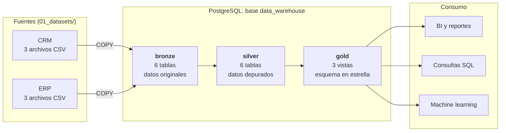

# Arquitectura de datos

El proyecto usa la arquitectura Medallion (Bronze, Silver, Gold) en **una sola base de datos** (`data_warehouse`) con un esquema por capa. No se usan bases de datos separadas porque en PostgreSQL no se pueden hacer consultas entre bases de datos.

## Diagrama de capas

## Detalle por capa

| Característica | Bronze | Silver | Gold |
|----------------|--------|--------|------|
| Esquema | `bronze` | `silver` | `gold` |
| Tipo de objeto | Tablas | Tablas | Vistas |
| Objetos | `crm_cust_info`, `crm_prd_info`, `crm_sales_details`, `erp_cust_az12`, `erp_loc_a101`, `erp_px_cat_g1v2` | Las mismas 6 tablas, con el mismo nombre | `dim_customers`, `dim_products`, `fact_sales` |
| Método de carga | Completa: `TRUNCATE` + `COPY` desde los CSV, con `CALL bronze.load_bronze();` | Completa: `TRUNCATE` + `INSERT ... SELECT` desde Bronze, con `CALL silver.load_silver();` | No aplica: las vistas leen de Silver en cada consulta |
| Transformación | Ninguna: copia fiel del CSV | Limpieza, estandarización, normalización, columnas derivadas y enriquecimiento | Integración CRM + ERP, reglas de negocio y claves subrogadas |
| Modelado | Ninguno | Ninguno | Esquema en estrella |
| Lee de | Archivos CSV | Solo Bronze | Solo Silver (excepción: `fact_sales` usa `dim_customers` y `dim_products`) |
| Columnas técnicas | No | `dwh_load_date` (por defecto `now()`) | No |
| Público objetivo | Ingenieros de datos | Analistas e ingenieros de datos | Analistas y usuarios de negocio |

## Reglas de la arquitectura

- Ninguna capa lee de una capa posterior ni se salta una capa.
- Los problemas de calidad se resuelven en Silver, nunca en Bronze ni en Gold. Ver [`data_quality_rules.md`](data_quality_rules.md).
- Los procedimientos de carga son atómicos: se ejecutan en una transacción y, si una tabla falla, ninguna queda a medias. Cada uno informa filas cargadas y duración por tabla.
- Las claves subrogadas solo existen en Gold, se generan dentro de la vista con `ROW_NUMBER()` y no son estables si cambian los datos de origen.

## Dónde está cada cosa

| Elemento | Archivo |
|----------|---------|
| Base de datos y esquemas | `03_scripts/init_database.sql` |
| Bronze | `03_scripts/bronze/ddl_bronze.sql`, `03_scripts/bronze/proc_load_bronze.sql` |
| Silver | `03_scripts/silver/ddl_silver.sql`, `03_scripts/silver/proc_load_silver.sql` |
| Gold | `03_scripts/gold/ddl_gold.sql` |
| Pruebas | `04_tests/test_silver.sql`, `04_tests/test_gold.sql` |

Siguiente: el recorrido de cada tabla en [`data_flow.md`](data_flow.md).
