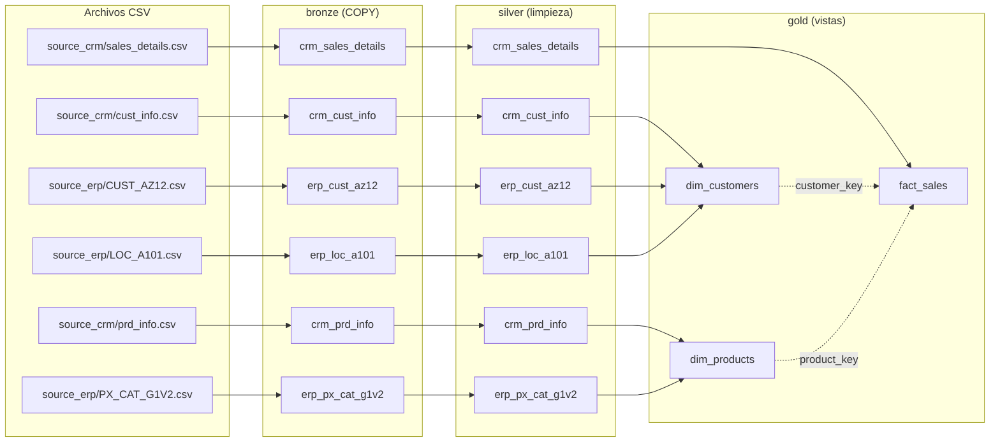

# Flujo de datos

Linaje de cada tabla de origen hasta las tres vistas de Gold. Cada flecha indica que la tabla de origen alimenta al objeto de destino.

La línea punteada es la única excepción a "Gold lee solo de Silver": `fact_sales` se une a las vistas `dim_customers` y `dim_products` para obtener las claves subrogadas.

## Qué alimenta a cada vista

| Vista de Gold | Tablas de Silver | Unión | Observación |
|---------------|------------------|-------|-------------|
| `dim_customers` | `crm_cust_info` (base) | n/a | Fuente maestra |
| | `erp_cust_az12` | `cst_key = cid` | Fecha de nacimiento y género de respaldo |
| | `erp_loc_a101` | `cst_key = cid` | País |
| `dim_products` | `crm_prd_info` (base) | n/a | Solo la versión vigente (`prd_end_dt IS NULL`) |
| | `erp_px_cat_g1v2` | `cat_id = id` | Categoría, subcategoría y mantenimiento |
| `fact_sales` | `crm_sales_details` (base) | n/a | Una fila por línea de venta |
| | `gold.dim_products` | `sls_prd_key = product_number` | Obtiene `product_key` |
| | `gold.dim_customers` | `sls_cust_id = customer_id` | Obtiene `customer_key` |

Todas las uniones de Gold son `LEFT JOIN`. En los datos actuales no hay huérfanos: cada venta tiene cliente y producto.

## Qué ocurre entre capas

| Paso | Procedimiento o script | Qué hace |
|------|------------------------|----------|
| CSV → Bronze | `bronze.load_bronze()` | Vacía cada tabla y la carga con `COPY`, sin transformar. Los campos vacíos pasan a `NULL`. |
| Bronze → Silver | `silver.load_silver()` | Vacía cada tabla y la rellena con `INSERT ... SELECT` aplicando las reglas de [`data_quality_rules.md`](data_quality_rules.md). Normaliza las claves ERP para que coincidan con `crm_cust_info.cst_key` y las claves de producto para que coincidan con las ventas. |
| Silver → Gold | `ddl_gold.sql` | Crea las vistas con `CREATE OR REPLACE VIEW`. No hay paso de carga: las vistas siempre reflejan Silver. |

## Relaciones entre las fuentes

| Origen | Destino | Clave en Silver |
|--------|---------|-----------------|
| `crm_sales_details` | `crm_prd_info` | `sls_prd_key = prd_key` |
| `crm_sales_details` | `crm_cust_info` | `sls_cust_id = cst_id` |
| `crm_cust_info` | `erp_cust_az12` | `cst_key = cid` |
| `crm_cust_info` | `erp_loc_a101` | `cst_key = cid` |
| `crm_prd_info` | `erp_px_cat_g1v2` | `cat_id = id` |

Las claves ERP (`cid`) y la clave de producto se normalizan en Silver; los formatos originales no coincidían.
