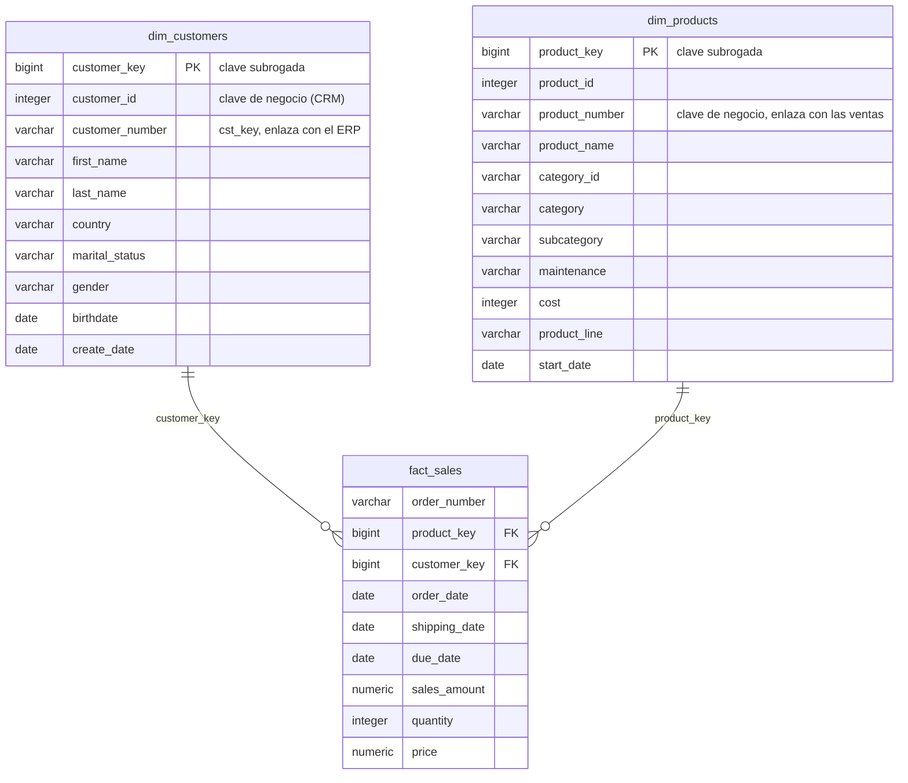

# Modelo de datos (Gold)

Esquema en estrella: una tabla de hechos (`fact_sales`) rodeada de dos dimensiones (`dim_customers` y `dim_products`). Los tres objetos son **vistas** del esquema `gold`, por lo que las claves y relaciones que se muestran son lógicas: la base de datos no define restricciones sobre ellas.

## Granularidad de la tabla de hechos

Cada fila de `fact_sales` es **una línea de pedido**: un producto dentro de un pedido. La combinación `order_number` + `product_key` es única (verificado en `04_tests/test_gold.sql`). Un mismo pedido puede tener varias filas, una por producto.

Medidas: `sales_amount`, `quantity` y `price`. Se cumple siempre `sales_amount = quantity * price`. `sales_amount` es aditivo y se puede sumar por cualquier dimensión; `price` es un precio unitario y no se debe sumar, solo promediar o comparar.

Fechas: `order_date`, `shipping_date` y `due_date`. Son atributos de la tabla de hechos; no hay una dimensión de fechas.

## Granularidad de las dimensiones

| Dimensión | Una fila por | Filas |
|-----------|--------------|-------|
| `dim_customers` | Cliente (`customer_id`) | 18 484 |
| `dim_products` | Producto vigente (`product_number`). No hay historial de versiones. | 295 |

## Relaciones

| Hechos | Dimensión | Cardinalidad | Unión (definida en la vista `fact_sales`) |
|--------|-----------|--------------|-------------------------------------------|
| `fact_sales.customer_key` | `dim_customers.customer_key` | Muchas ventas por cliente | `sls_cust_id = customer_id` |
| `fact_sales.product_key` | `dim_products.product_key` | Muchas ventas por producto | `sls_prd_key = product_number` |

Las claves subrogadas (`customer_key`, `product_key`) se generan dentro de la vista con `ROW_NUMBER()` y **no son estables**: pueden cambiar si cambian los datos de origen. No se deben guardar fuera del almacén. Para enlazar con otros sistemas se usan las claves de negocio (`customer_id`, `customer_number`, `product_number`).

Descripción de cada columna: [`data_catalog.md`](data_catalog.md).
